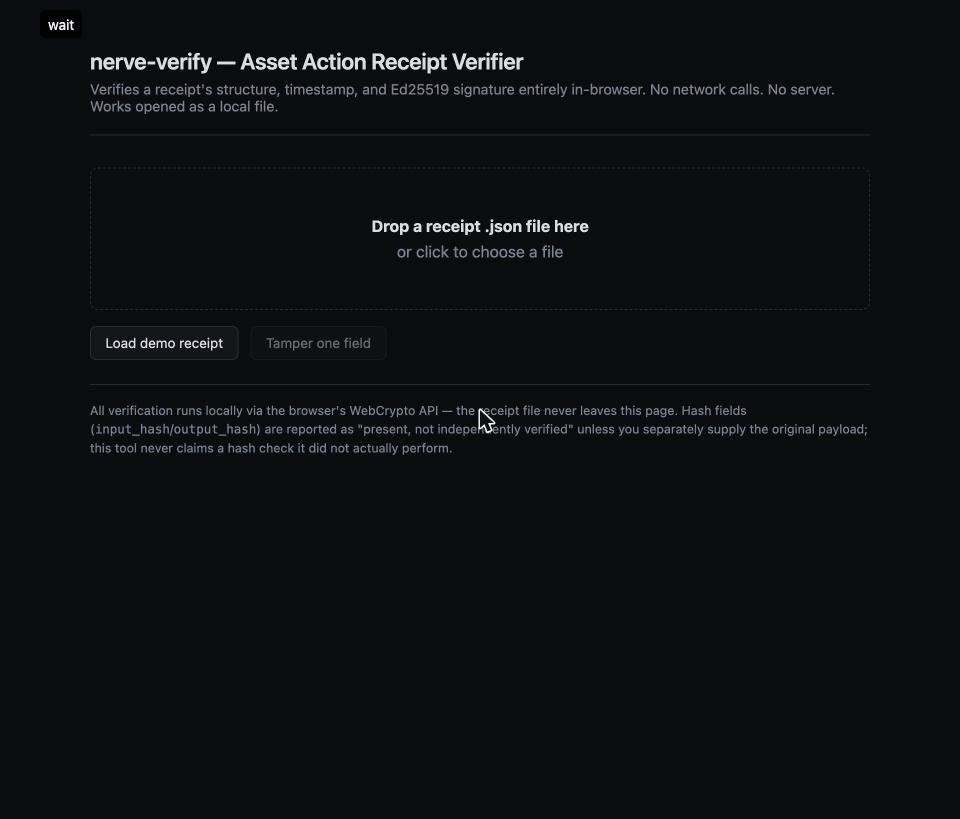

# nerve-verify

[](https://github.com/ricocyber/nerve-verify/actions/workflows/tests.yml)
[](LICENSE)
[](https://ricocyber.github.io/nerve-verify/)

**Your AI agent says it did X. Prove it.**

**The gate is proprietary. The proof is public.**

**[Try it in your browser →](https://ricocyber.github.io/nerve-verify/)** Load a signed receipt, change one
field, and watch the signature break. Nothing leaves your machine.



NerveSystem sits between AI agents and the physical world. Every action it approves or
refuses produces a signed Asset Action Receipt (AAR). `nerve-verify` lets anyone check a
receipt themselves — offline, without trusting NerveSystem's servers, and without access
to a live deployment.

A governance system that certifies its own receipts asks you to take the vendor's word.
This tool doesn't. It treats every receipt as untrusted and re-derives every check from
scratch using public cryptographic primitives only (Ed25519, SHA-384).

## 60-second quickstart

```bash
python3 -m venv .venv
.venv/bin/pip install -e ".[dev]"

# Fastest way to see what this does:
.venv/bin/nerve-verify tamper-demo
```

`tamper-demo` verifies a pre-signed demo receipt (PASS), changes one field without touching
the signature, and verifies again (FAIL).

```
=== STEP 1: valid receipt ===
  [PASS] schema, timestamp, input_hash, output_hash, signature
  verdict: PASS

=== STEP 2: one field flipped (confidence changed, signature untouched) ===
  [FAIL] signature: signature verification failed
  verdict: FAIL
```

## Commands

```bash
# Check one receipt
.venv/bin/nerve-verify check fixtures/valid/valid_00.json

# Check against a known-good public key (origin authentication)
.venv/bin/nerve-verify check receipt.json --pin-key <hex>

# Recompute hashes when you hold the original payloads
.venv/bin/nerve-verify check receipt.json --input-file in.bin --output-file out.bin

# Check a directory of receipts for ordering and duplicate IDs
.venv/bin/nerve-verify chain path/to/receipts/

# Machine-readable output for scripts and CI (works on check and chain)
.venv/bin/nerve-verify check receipt.json --json

# Run the test suite (10 valid + 6 adversarial fixtures)
.venv/bin/python -m pytest tests/ -v
```

No network calls. Everything runs on your machine.

Exit codes: `0` PASS, `1` FAIL, `2` unreadable input or bad usage.

## Install from GitHub

```bash
pip install git+https://github.com/ricocyber/nerve-verify.git
nerve-verify tamper-demo
```

## GitHub Action

Fail a CI job when any receipt fails verification:

```yaml
- uses: actions/checkout@v4
- uses: ricocyber/nerve-verify@main
  with:
    path: receipts/          # a .json file or a directory of receipts
    # pin-key: <hex>         # optional, single-file mode: authenticate origin
```

## Web verifier

Open `web/index.html` in a browser, drop a receipt `.json` on it, and get the same
PASS/FAIL breakdown. It runs fully client-side via WebCrypto — the file never leaves the
page. Ed25519 in WebCrypto is not yet in every browser; if yours lacks it, the page says
so. The CLI is the authoritative check.

## What this tool does NOT claim

A verifier that oversells itself is worse than none.

- **No hash recomputation without the source data.** Receipts carry hashes, not payloads.
  Without `--input-file`/`--output-file`, hash fields report "present, well-formed, not
  independently verified" — never a false PASS.
- **`chain` checks what it says, nothing more.** Each receipt, plus timestamp ordering and
  duplicate IDs across a directory.
- **No proof of origin by default.** A signature checked against the key embedded in the
  same receipt proves self-consistency, not that it came from a specific deployment. Use
  `--pin-key` for real origin authentication.

## Demo keys

Every fixture is signed with a throwaway keypair generated for this repo and labeled
`DEMO` (`fixtures/demo_key.json`). No production key material is in this repository.

## Layout

```
nerve_verify/crypto.py   canonical serialization, hashing, Ed25519 verification
nerve_verify/chain.py    directory-level ordering/duplicate checks
nerve_verify/cli.py      check / chain / tamper-demo
tests/                 pytest suite (valid and adversarial cases)
fixtures/              sample receipts (valid and adversarial)
web/index.html         in-browser verifier, no server, no framework
```

## License

Code: MIT (see `LICENSE`). NerveSystem is patent pending — see `PATENTS.md`.
